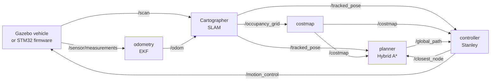

# CarControl

An autonomy stack for a small Ackermann-steered RC car, built from scratch on ROS 2. The car maps an unknown environment with a 2D LiDAR, localizes itself in that map, plans a kinematically feasible path to a goal, and follows it forward and in reverse.

The stack runs in a Gazebo simulation, locally or headless on a cloud VM, and includes STM32 firmware for the vehicle's sensors and actuators.

## Features

- **SLAM:** 2D mapping and localization with Cartographer, using LiDAR and wheel/IMU odometry
- **State estimation:** Extended Kalman Filter for the rear-axle pose and speed
- **Costmap:** obstacle inflation with an exponential cost decay, based on a distance transform
- **Path planning:** Hybrid A* with forward and reverse motion, footprint collision checking, and continuous replanning
- **Path tracking:** Stanley controller with risk- and direction-aware speed control
- **Simulation:** Gazebo Harmonic model generated from a shared vehicle configuration
- **Cloud workflow:** Docker image, on-demand CI build, and one-command runs on a GCP Spot VM
- **Monitoring:** live visualization through Foxglove
- **Embedded:** FreeRTOS and micro-ROS firmware for an STM32F446RE

## Architecture



## How it works

### State estimation (`App/src/odometry`)

An EKF based on [TinyEKF](https://github.com/simondlevy/TinyEKF) estimates the rear-axle state `(x, y, v, ψ)`. The rear axle is used because the no-sideslip constraint of the kinematic bicycle model holds there.

- **Inputs:** longitudinal acceleration and gyro yaw rate
- **Measurement:** wheel-encoder speed
- **Output:** `/odom` and the `odom → base_link` pose, with the twist expressed at the chassis

Heading is integrated from the gyro. Cartographer corrects the resulting drift in the map frame.

### Costmap (`App/src/costmap`)

The costmap converts the occupancy grid into traversal costs:

| Cell | Cost |
|---|---:|
| Free, outside the inflation radius | 0 |
| Inflation zone | exponential decay |
| Unknown | 50 |
| Within the inscribed radius of an obstacle | 98 |
| Occupied | 100 |

The inscribed radius equals the radius of the footprint circles used by the planner, so a cost of 98 or more means that a circle centered on that cell collides.

### Planner (`App/src/planner`)

The planner runs Hybrid A* for the rear axle over an `(x, y, θ)` lattice.

| Parameter | Value |
|---|---|
| Lattice resolution | 5 cm, 36 heading bins |
| Motion step | 7.5 cm along a bicycle-model arc |
| Motion primitives | forward and reverse, each left, straight, right |
| Planning steering limit | 90% of maximum steering |
| Edge cost | distance, weighted by costmap risk |
| Penalties | reverse ×2, turning ×1.1 |
| Heuristic | Euclidean distance to goal |
| Collision model | 3 circles along the vehicle body |
| Replanning | 1 Hz |

During replanning, the path up to a reachable low-cost node ahead of the vehicle is kept and only the remainder is replaced. This keeps the reference stable while the map grows.

### Controller (`App/src/controller`)

The controller splits the path at direction changes and applies a Stanley law to the current segment:

- **Forward:** tracks the front axle
- **Reverse:** tracks the rear axle with mirrored steering
- **Steering:** heading error plus `atan(k · cte / (v_soft + v_max))`
- **Speed:** reduced as the steering error grows, with stricter limits when reversing or in high-risk areas

### Simulation (`Testing/ros_simulation`)

- `generate_model.py` renders the Gazebo car model from `config.yaml`, keeping simulation and software parameters consistent.
- A forked Ackermann steering plugin drives the vehicle.
- `gazebo_msg_bridge` converts Gazebo sensor data and commands to the same ROS interfaces used by the firmware.
- Sensors include a simulated 360° LiDAR (640 samples, 10 Hz) and an IMU with configurable noise.
- Headless mode renders the LiDAR through EGL and Mesa, so no GPU or display is required.

### Firmware (`Controller`)

The firmware targets an STM32F446RE and runs FreeRTOS. It reads an MPU6050 IMU, a CJMCU-103 steering angle sensor, and a wheel encoder, runs sensor calibration and PI motor control, and communicates with ROS 2 through micro-ROS over UART.

## Vehicle

| Parameter | Value |
|---|---:|
| Length | 170 mm |
| Width | 115 mm |
| Wheelbase | 140 mm |
| Track width | 100 mm |
| Maximum steering angle | 0.9 rad (51.6°) |

Shared parameters live in [`App/src/common/config/config.yaml`](App/src/common/config/config.yaml). It is compiled into a C++ header, so changes require a rebuild.

## Getting started

Clone the repository with its submodules:

```bash
git clone --recursive https://github.com/ValenStein1993/CarControl.git
cd CarControl
```

### Run with Docker (recommended)

```bash
docker build -f Docker/Dockerfile -t carcontrol-sim .
docker run --rm -it --shm-size=1g -p 127.0.0.1:8765:8765 carcontrol-sim
```

Open [Foxglove](https://foxglove.dev), connect to `ws://localhost:8765`, and import the layout from `Testing/ros_simulation/src/startup/src/foxglove.json`.

### Run natively

Requires Ubuntu 24.04, ROS 2 Jazzy, Gazebo Harmonic, `ros_gz`, Cartographer, `foxglove_bridge`, OpenCV, and Eigen. The [Dockerfile](Docker/Dockerfile) lists the exact packages.

```bash
source /opt/ros/jazzy/setup.bash
(cd App && colcon build)

./Scripts/run_sim.sh    # terminal 1: Gazebo
./Scripts/run_app.sh    # terminal 2: autonomy stack
```

Build from `App/`, not from `App/src/`.

### Run on Google Cloud

Set your project, region, and machine type at the top of [`Scripts/gcp_sim.sh`](Scripts/gcp_sim.sh), then run:

```bash
./Scripts/gcp_sim.sh start            # newest image
./Scripts/gcp_sim.sh start <commit>   # image of a specific commit
./Scripts/gcp_sim.sh stop             # delete the VM and its disk
```

`start` creates a Spot VM, starts the simulation, opens an SSH tunnel for Foxglove, and streams the logs. Pressing Ctrl+C closes the tunnel but leaves the VM running. The VM deletes itself after 4 hours, configurable with `MAX_RUN=2h`.

### Build the image in CI

The [GitHub Actions workflow](.github/workflows/docker-image.yml) builds the image on demand and pushes it to Artifact Registry, tagged with the short commit hash and `latest`. It authenticates through Workload Identity Federation, so no service account keys are stored.

```bash
gh workflow run docker-image.yml --ref master
```

## Repository structure

```text
App/src/
  common/       shared configuration, utilities, base node
  messages/     custom ROS 2 messages (car_msgs)
  odometry/     EKF
  costmap/      costmap generation
  planner/      Hybrid A*
  controller/   Stanley path tracking
  startup/      launch file for the autonomy stack
Controller/     STM32 firmware
Testing/
  ros_simulation/   Gazebo model, worlds, plugins, bridge
Docker/         simulation image
Scripts/        build, run, and cloud scripts
CAD/            mechanical parts
```

## Known limitations

- The controller's heading reference is piecewise constant along curved path segments, which makes the steering command oscillate.
- Unknown cells have a moderate cost, so the planner can route through unexplored space.
- The EKF has no absolute heading measurement, no gyro bias state, and no steering model.
- The goal is static and set in the configuration.

## Roadmap

- Continuous path tangent in the controller
- Steering pseudo-measurement and gyro bias estimation in the EKF
- MCAP recording of simulation runs
- Parametrization of the PI controller
- Time synchronization between the STM32 and Raspberry Pi using round-trip synchronization
- LiDAR scan distortion compensation
